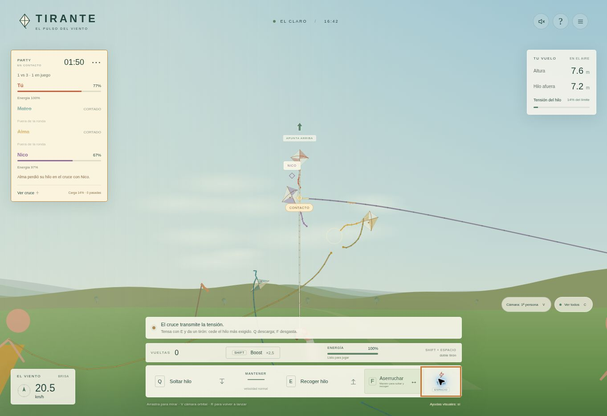
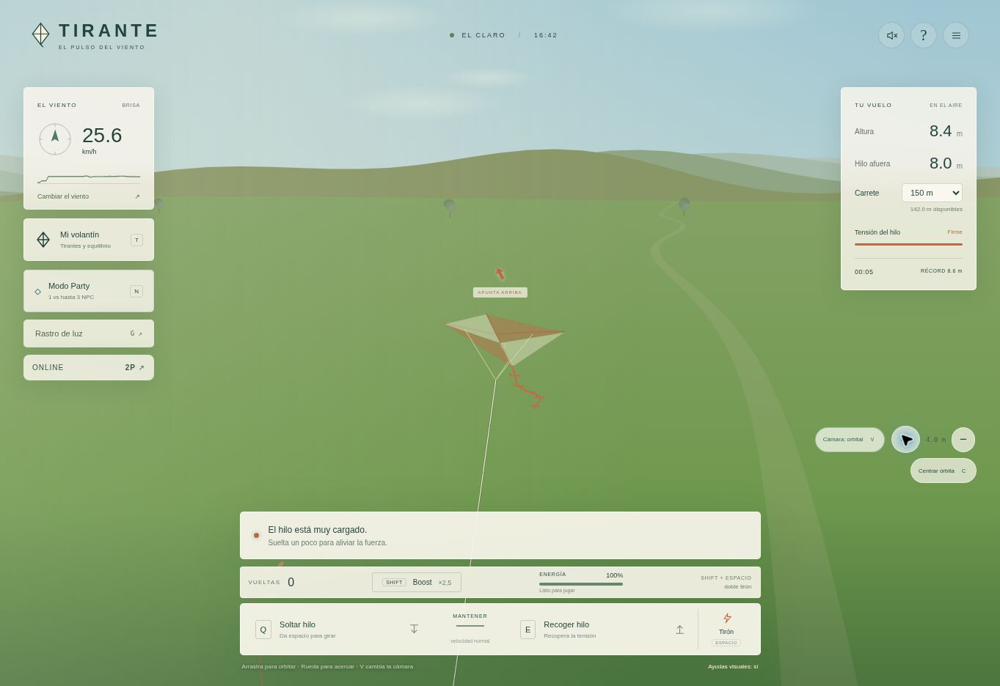

# Validación de la exportación

## Cruces, tensión y ráfagas · versión 1.9.0 · 24 de octubre de 2026

Validación local con Node.js 24.19.0:

- `npm run build`: 47 módulos. `npm test`: todas las suites y las 9 pruebas de integración HTTP/SQLite aprobadas.
- Regresiones que verifican que un cruce no detenga un hilo distante y que un cruce iniciado a 1 mm entre al cálculo de contacto y carga. Se conservan las pruebas de separación continua y los 827.631 pares de segmentos de Party.
- Dos reproducciones con Party de cuatro volantines, carrete de 150 m, viento de 9 y 12 m/s, fases de viento de 60 y 15 s y alternancia brusca de soltar/recoger con boost. En 1.8 llegaban al límite de ronda de 120 s con bloqueos repetidos; ahora terminan en 6,36 y 5,93 s desde la preparación. El intervalo continuo de inmovilidad con bloqueo superior al 99 % es 0 s en ambas. Se desactiva la ráfaga extraordinaria en esta prueba para aislar el arreglo de contacto.
- Un cruce cerca del límite permanece intacto sin tirón y fractura el material más gastado al tirar. Intercambiar el hilo gastado intercambia al perdedor; no favorece al jugador. Se prueban empates, autoenredos, ausencia de daño a distancia, recuperación de picos, punto exacto de corte y retroceso de los extremos.
- Un enredo controlado con desplazamiento rechazado se libera por fractura en 1,09 s. El mismo caso soltando hilo no se corta. Duplicar doce veces los contactos no multiplica la exposición.
- `npm run test:wind`: 1.000 vuelos de hasta 40 s, perfil firme, base de 9 m/s, configuración inicial y sin maniobras. 113 recibieron la ráfaga y se cortaron (11,3 %); los otros 887 no se cortaron. Una muestra separada de 10.000 semillas seleccionó 1.037 ráfagas (10,37 %). Son muestras deterministas reproducibles, no una tasa garantizada para cualquier forma de jugar.
- Con la misma semilla de ráfaga, soltar rápido con boost conserva la hebra que se corta al mantenerla tensa. Esa defensa no garantiza seguir en el aire: el giro todavía puede llevar el volantín al suelo.
- El estado de sobrecarga y el resultado permanecen iguales tras guardar/restaurar la simulación; ambos asientos reciben la misma carga y causa del corte. Se mantienen las pruebas de reconexión y continuidad visual online.

Repetir: `npm run build && npm test`, y `npm run test:wind` para la muestra extensa de viento.

El commit `8a59be9` llegó a `live` en Render. `/healthz` respondió con versión 1.9.0 y los diez archivos de cliente modificados coincidieron byte por byte con el repositorio. En navegador se jugó Party de cuatro volantines: se realizaron tirones, recogida con boost y aserruchado, el hilo pasó de 8,0 a 7,2 m, se eliminaron dos NPC y la partida continuó con el rival restante. La barra y el detalle de cruce muestran el porcentaje de carga. La captura siguiente usa Canvas, porque el navegador de comprobación no dispone de WebGL; no representa una medición de FPS en GPU.

En una sala online de 150 m con viento firme de 9 m/s, dos pestañas mostraron simultáneamente 01:24, 8,6 m de altura y 22 % del límite. Después de un tirón y recogida con boost del primer asiento, ambos mostraron 01:17: el primer hilo tenía 7,1 m y el segundo conservaba 8,0 m. Se cerraron ambos asientos. Render no devolvió registros de error durante esta comprobación.



## Rendimiento y vuelo · versión 1.8.0 · 24 de octubre de 2026

Validación local con Node.js 24.19.0:

- `npm run build`: 43 módulos comprobados. `npm test`: todas las suites y las 9 pruebas de integración HTTP/SQLite aprobadas.
- Se compararon los candidatos de colisión y su orden contra una búsqueda exhaustiva, con 50 escenas deterministas, 1–4 hilos, movimiento barrido, diferentes radios, fracturas y cambios de orden. En cuatro hilos largos separados se reducen las comprobaciones de límites de 6.216 a 600.
- Siguen pasando los cruces rápidos, contactos tangentes, autoenredos, desgaste y fracturas; la prueba de Party inspecciona 827.631 pares de segmentos. La interpolación visual también conserva la separación y libera el hilo cuando el servidor confirma un corte.
- Se verifica la continuidad de volantín, hilo y animación del papel al recibir un paquete antes de acabar la transición anterior, desde ambos asientos. Cambiar de sala o de ronda descarta la transición anterior. Una prueba adicional reproduce un fotograma por paquete: las pestañas lentas o en segundo plano recuperan la posición en vez de reiniciar siempre la interpolación desde cero.
- Se inspeccionan los materiales y la geometría real de Three.js sin GPU: opacidad 0,4, transparencia en una pasada, paneles completos sin triángulos superpuestos, UV continuas, 112 vértices por vela y normales finitas. Las llamadas de dibujo de Canvas comprueban el 40 % en papel clásico, liso y estampado, sin acumular dos capas de opacidad.
- El terreno mide 800 × 800 m, con 8.192 triángulos en vez de 20.000, y no contiene instancias de pasto ni flores. El radio de 150 m permanece plano; los árboles empiezan a 210 m, las montañas a 360 m y la niebla a 190 m. La distancia de cámara aumenta a 1.200 m.
- Con la misma configuración de vuelo y soltando tras 8 segundos, la primera vuelta pasa de 2,1625 s a 2,0125 s. Las pruebas de vuelo estable, recuperación y picada siguen aprobadas. El recorrido original de contrarreloj se completa en 30,83 s con soltadas algo más cortas; sus puntos, radios y medallas no se alteraron.

Microcomparación local contra `d97f928` (mediana de cinco ejecuciones de 1.800 actualizaciones; animación precalentada durante 300 actualizaciones):

| Trabajo de CPU | Antes | 1.8.0 |
| --- | ---: | ---: |
| Animación de un volantín con cola | 136,13 ms | 78,63 ms |
| Comprobación del movimiento de cuatro hilos largos separados | 79,50 ms | 26,49 ms |

Son mediciones de funciones aisladas, no FPS del juego ni garantías para todos los dispositivos. La comprobación visual en el navegador disponible usa el renderer Canvas porque ese entorno no ofrece WebGL; no se ha medido rendimiento en una GPU real.

Comprobación en Render: los commits de implementación `f66eee7` y `a34b392` llegaron a `live`; `/healthz` devuelve la versión 1.8.0. Los módulos publicados se compararon byte por byte con el repositorio. Se probó vuelo libre con carrete de 150 m, cámara orbital y dos sesiones de navegador en una sala de 150 m. Tras alternar pestañas, ambos asientos mostraron 8,5 m de altura y el reloj 01:13; un tirón redujo el hilo de 8,0 a 7,7 m. Se cerraron los dos asientos de prueba. La consulta de registros de error del servicio no devolvió errores durante la verificación.



## Reparación de Render · 24 de octubre de 2026

El despliegue original `Tirante` era un Static Site que publicaba la raíz del repositorio. Su HTML pedía `/app.js` y `/style.css`, que devolvían 404. Las API tampoco se ejecutaban. El build estaba correcto; el tipo de servicio y la entrada publicada no correspondían al servidor de esta exportación.

Se creó el Web Service gratuito `tirante-vuelo`, desde `main`, con Node 24.19.0, `npm ci && npm run build`, `npm start`, una instancia y datos temporales en `/tmp/tirante-data`. Su primer despliegue llegó a `live`. La configuración se administra directamente en Render; los YAML del repositorio siguen siendo plantillas opcionales.

Comprobaciones realizadas:

- El build y todas las pruebas automatizadas de la exportación pasan localmente.
- En `https://tirante-vuelo.onrender.com`, la página inicial, JavaScript, CSS y Three.js responden con HTTP 200 y sus tipos de contenido correctos. `/healthz` devuelve `ok: true` y `storage: sqlite+files`.
- Se abrió el sitio en un navegador, se inició el vuelo libre y se lanzó el volantín. El navegador de pruebas no dispone de WebGL; se comprobó el renderer Canvas alternativo, sin modificar el renderer 3D.
- Dos pestañas independientes crearon y unieron una sala, marcaron ambos jugadores como listos y mostraron el duelo en juego con el mismo reloj. Se cerraron los asientos de prueba al terminar.
- Se cargó un PNG sintético por `/api/prints` y se verificó que su descarga devolviera exactamente los mismos bytes.
- La redirección del `index.html` de la raíz conserva tanto los parámetros como `#sala=...`. `game/index.html` permanece como entrada del servidor, sin cambios.
- Se restituyeron `.gitignore`, `.node-version` y `.env.example`, mencionados en la exportación pero ausentes de la carga inicial a GitHub.

Esta instalación gratuita no conserva salas ni estampados tras reinicios o nuevos despliegues. No se añadió un disco de pago. La [captura de comprobación](tirante-render.jpg) corresponde al navegador sin WebGL.

## Comprobaciones originales de la exportación

Fecha: 23 de octubre de 2026. Entorno de comprobación: Linux, Node.js 24.19.0.

## Resultados

- `npm ci`: instalación correcta desde el archivo de bloqueo, sin dependencias npm externas.
- `npm run build`: sintaxis de los 39 módulos JavaScript y archivos de entrada correctos.
- `npm test`: todas las suites de vuelo, hilo, anclajes, cámaras, comisiones, Party, online, colisiones continuas, contrarreloj, personalización y estampados completadas sin fallos.
- `tests/server.test.mjs`: 9 pruebas aprobadas. Incluye entrega HTTP del juego, errores de solicitudes, dos asientos con autorización, rechazo de un tercer jugador, entradas concurrentes, carga y descarga de estampados, límites de carga y recuperación de datos después de cerrar y reabrir el servidor.
- `render.yaml` y `render-free.yaml`: válidos contra el esquema JSON público de Blueprint consultado el día de la exportación. También se contrastaron runtime, comandos, variables, disco y health check con la documentación oficial de Render.
- Los 24 archivos de `game/` coinciden byte por byte con el proyecto original en el commit `9fa2925c52902c2aa917e38b6d5f9cdfbb350248`. El proyecto original no se modificó durante la exportación.

La prueba de persistencia usa una carpeta temporal, crea una sala de dos personas y un estampado, reinicia el servidor con esa misma carpeta y recupera el asiento, la configuración, el estado físico y la imagen. La persistencia en Render requiere usar el disco configurado en `render.yaml`.

Los YAML fueron validados localmente. No se ha realizado un despliegue en una cuenta de Render ni una prueba de carga de múltiples salas simultáneas. La configuración gratuita tiene menos CPU y no conserva el almacenamiento al reiniciar. El juego y su interfaz no se modificaron en esta exportación; la validación nueva se concentró en el servidor y la portabilidad.

## Repetir las comprobaciones

```sh
npm ci
npm run build
npm test
```

Para ejecutar únicamente la integración del servidor:

```sh
node --test tests/server.test.mjs
```

El modelo físico sigue teniendo el alcance descrito en `MODELO_Y_CAMBIOS.md`; aprobar las pruebas no equivale a certificar una precisión física porcentual.
