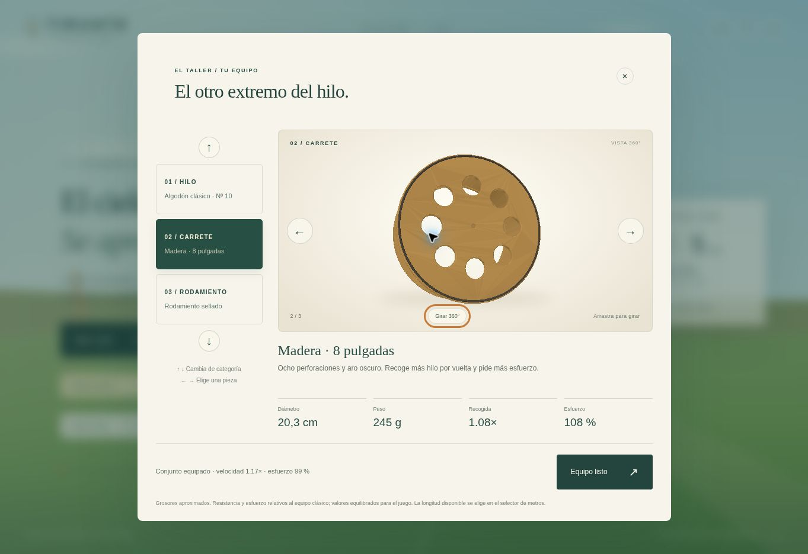
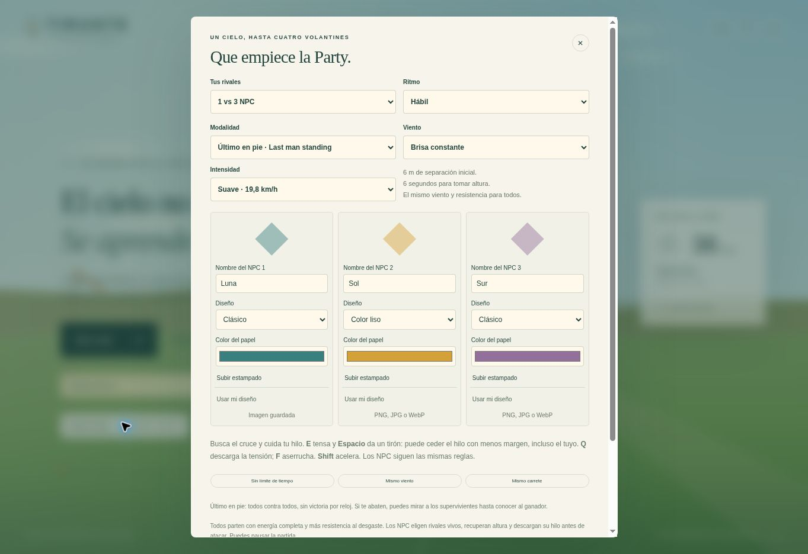

# Validación de la exportación

## Soltada, tirantes y carretes largos · 1.13.0 · 26 de octubre de 2026

- `npm run build`: 66 módulos comprobados. `npm test`: batería completa aprobada y diez pruebas de integración del servidor, incluidas salas de 300 y 1000 yardas.
- Se reprodujo la inestabilidad previa: 22 g, sin cola y ráfagas de 12 m/s superaban 420 m/s antes de un segundo. La integración nueva usa subpasos para el cuerpo, amortiguación aerodinámica estable y tensión radial implícita; conserva el paso de 240 Hz y el movimiento barrido completo de las colisiones.
- `tests/payout-stability.mjs`: 72 combinaciones de masa, cola, viento y fase inicial, con soltada, recogida con boost y tirones. Velocidad máxima de la muestra: 15,24 m/s; estiramiento máximo: 2,91 m. Sin velocidades explosivas ni valores no finitos. Tres secuencias con el solucionador real de contactos y capacidades de 150 m, 300 yd y 1000 yd no desplazan el volantín más de 0,25 m por paso.
- Se comprueban límite y estabilidad a capacidad completa, desgaste más allá de 150 m, guardado/restauración online y las tres listas de capacidad. Los 914,4 m caben dentro del terreno plano; se amplían horizonte, niebla y cámara sin aumentar los segmentos del hilo ni la malla del suelo.
- Cuatro montajes asimétricos verifican que las puntas de los tres tirantes y el extremo del hilo comparten exactamente el mismo punto. También se comprueba durante la interpolación online con rotación. El ajuste visual de primera persona conserva ese extremo, los tramos cortados y todos los puntos físicos originales.
- Se rechazan récords imposibles como el de la captura del fallo, sin perder los récords válidos ni las demás preferencias. Las pruebas de vuelo ligero, picada, recuperación, Party, cortes, cámaras y Rastro siguen aprobadas.
- `npm run test:wind`: 1000 vuelos con viento fuerte; 113 seleccionados para ráfaga extraordinaria y 113 cortes (11,3 %), cero cortes en los otros vuelos y cero aterrizajes. Es una muestra determinista, no una tasa garantizada para cualquier maniobra.

El commit `7ce02627e3268b1c31d71c81ba5ccc51de1dd006` llegó a `live` en Render. `/healthz` devolvió 1.13.0. Diez archivos publicados, incluidos física, hilo, escenas, configuración de capacidad, interpolación e interfaz, coincidieron byte por byte con el repositorio.

En la web se eligió 1000 yd desde preparación y se lanzó el volantín. Una soltada sostenida elevó el contador de 8,0 a 11,8 m; después de recogida, soltada con boost y tirón llegó a 15,2 m, con valores finitos y una caída normal al tirar hacia abajo. Se relanzó y se verificó el carrete desde el borde inferior derecho. La cámara orbital a 2,7 m muestra el hilo llegando a la unión de los tres tirantes. Capturas reales: [primera persona](tirante-1-13-carrete.jpg) y [unión de tirantes](tirante-1-13-tirantes.jpg).

El navegador de comprobación tiene WebGL deshabilitado y usa Canvas. No se observaron errores de la aplicación aparte del aviso esperado de ese cambio de renderer. La geometría WebGL y las proyecciones se verifican en las pruebas; no se realizó una revisión visual en GPU ni una medición de FPS.


## Inicio, carrete y unidades · 1.12.0 · 26 de octubre de 2026

- `npm run build`: 64 módulos comprobados. `npm test`: batería completa aprobada, incluidos física, hilos, cruces, Party, equipo, espectador, persistencia online y nueve pruebas del servidor.
- `tests/game-flow.mjs`: título/menús/selección/preparación, ninguna partida iniciada por editar, botón de inicio para los cinco modos, IDs únicos, conversiones yd/m, viewport del carrete dentro de seis tamaños de pantalla, restauración del viewport WebGL y anclaje inalterado.
- Rayos sobre puntos interiores y exteriores del terreno: una sola superficie de suelo por punto. Borde exterior a altura cero. La escena de primera persona contiene únicamente el carrete, sin mano.
- Corte: posición continua y dirección conservada, límite inicial de 8 m/s, incremento lateral máximo de 4 m/s². Se mantienen las regresiones de vuelo ligero, orientación de picada, diferencias por viento y masa, aterrizaje y convergencia al cambiar el paso.
- Navegación en la web publicada: Enter → menú → configuración → modos → preparación. Taller, equipo y viento regresan a preparación sin comenzar. Cambio a carrete de 8 pulgadas y capacidad de 164,0 yd (150,0 m), con resumen correcto.
- Inicio real de vuelo libre, Party con dos NPC competitivos, Último en pie y Rastro. Rastro mantiene equipo, viento y longitud fijos y permite cambiar el diseño. El menú permite volver a elegir un modo.
- Online: condiciones desde preparación y desde el lobby; guardado vuelve a la pantalla correspondiente. Sala creada con 109,4 yd (100,0 m), después abandonada y regreso al menú. Los duelos de dos clientes siguen cubiertos por pruebas automatizadas del servidor; esta revisión web no jugó una ronda con dos humanos.
- Contador: cifra principal de 22 px y equivalencia en metros de 10 px. Capturas reales: [preparación](tirante-1-12-preparacion.jpg) y [primera persona sin mano](tirante-1-12-carrete.jpg).

La sesión de navegador tiene WebGL deshabilitado y activa Canvas. No hubo errores de la aplicación durante el recorrido, aparte del aviso esperado al usar ese renderer. La geometría, los materiales y el viewport de WebGL se verificaron por pruebas; queda sin comprobar visualmente en una GPU real el parpadeo del terreno. `/healthz` confirmó 1.12.0 y Render publicó el commit `1413dbfb2febc6cc61a4b14da989eeb516a6210a` antes de la revisión web.

## Planeo, cola y equipo · 1.11.0 · 26 de octubre de 2026

- Pruebas de caída desde 20 m: viento de 0, 5,5, 9 y 12 m/s, orientación de salida y masas de 22, 34 y 70 g. La deriva aumenta con el viento; la picada inicial desciende más que la orientación horizontal; todos los estados permanecen finitos y terminan en tierra. Con el peso por defecto, las muestras de salida nivelada tardan aproximadamente 14–16 s en caer. Son escenarios deterministas, no una duración universal.
- El integrador de caída converge entre 120 y 240 Hz y continúa idéntico después de guardar/restaurar el estado online. El corte sigue liberando el hilo; no se vuelve a introducir contacto con hebras eliminadas.
- Se comprueban validación y persistencia del equipo, resistencia de cada hilo, desgaste comparado, velocidad y gasto del rodamiento, y equipamiento equivalente para los NPC.
- La cola conserva inercia durante un giro, responde al viento, mantiene las longitudes acotadas y se congela al pausar. Los vértices y normales del papel y la cola son finitos.
- Los diez modelos tienen una sola malla por objeto y menos de 12.000 triángulos. Un rayo atraviesa realmente las perforaciones del carrete; los huecos no son círculos pintados.
- Las cámaras separan seguimiento del volantín cortado, vista desde la punta y batalla. Se puede seguir observando después del resultado y también cuando el último participante cae.

`npm run build`: 59 módulos. `npm test`: suites completas y 9 pruebas HTTP/SQLite aprobadas. El rasterizador alternativo comprueba profundidad por píxel: la oclusión no depende del orden de las caras y el espacio vacío sigue siendo transparente. En una medición local de 60 vistas del carrete, a 630 × 340 píxeles, el dibujo tarda 10,7 ms de media; esta medida de CPU no equivale a FPS en una GPU o teléfono.

En Render se verificaron las flechas ↑/↓ para categoría y ←/→ para pieza; el cambio de grosor a 0,35 mm actualiza resistencia y desgaste; el carrete de 8 pulgadas y el rodamiento sellado se conservan tras recargar, con velocidad combinada 1,17× y esfuerzo 99 %. Se comprobó el giro automático, su pausa y el arrastre manual hasta el reverso abierto con eje de madera.

En una ronda real con tres NPC, tras aterrizar el jugador, el reloj continuó de 00:11 a 00:24 con rivales activos. «A bordo» activó la cámara de la punta; «Mi volantín» volvió a la órbita; «Ver todos» recuperó la batalla. La ronda terminó a los 25 s y «Resultado» → «Seguir mirando» conservó la escena terminada. Las caídas en el aire se validan además con los escenarios físicos deterministas anteriores.

El navegador de pruebas tiene WebGL deshabilitado: la revisión visual usa Canvas, incluyendo el visor 3D de equipo con prueba de profundidad. No se ha medido rendimiento en una GPU real. Los módulos publicados se comparan byte por byte con el repositorio y `/healthz` confirma 1.11.0.



## Party configurable y último en pie · 1.10.0 · 24 de octubre de 2026

- `npm run build`: 50 módulos. `npm test`: suites completas y 9 pruebas HTTP/SQLite aprobadas.
- Se verifican nombres y diseños independientes, sanitización de ajustes, persistencia de la configuración, perfil/intensidad de viento, separación mínima de 6 m y preparación de 6 s.
- Pruebas de espectador: la eliminación del jugador no termina una ronda con varios supervivientes; el objetivo cambia al siguiente piloto vivo; la cámara general excluye al jugador abatido; la IA deja de atacarlo. Último en pie continúa incluso después de 600 s de reloj si quedan dos participantes y termina únicamente con un ganador o una eliminación simultánea.
- Ocho partidas naturales de Último en pie (brisa/firme, Hábil/Competitivo, jugador quieto/aserruchando) terminaron con ganador. En brisa, Hábil y tres NPC, el jugador quieto pierde a los 106 s y aserruchando gana a los 103 s. La versión 1.9 resolvía esos casos a los 19 y 15 s. Son escenarios con semillas fijas, no una duración garantizada.
- En Competitivo, el jugador pierde las cuatro muestras de brisa/firme y quieto/aserruchando: mantener F ya no asegura ganar. Se comprueban por separado la descarga defensiva, el descanso con poca energía y el tirón oportunista sin privilegios físicos.
- El trabajo de roce que antes agotaba una hebra ahora deja más del 30 % de integridad. Un doble tirón bien situado aún puede cortar el hilo con menor margen, incluido el propio. El enredo controlado se libera en 1,19 s, y soltando permanece intacto.
- La cuerda de un jugador aterrizado se libera una sola vez antes de las colisiones, sin bloquear ni dañar al superviviente. Los resultados online siguen distinguiendo aterrizaje y corte en el aire.
- Opacidad real 0,45 comprobada en materiales WebGL y llamadas Canvas, incluidos los estampados; geometría, giros, contrarreloj, sincronización y persistencia siguen pasando sus regresiones.

Los commits de implementación `bbc52a5` y `5d824b1` llegaron a `live` en Render. En la web se guardaron Luna, Sol y Sur como nombres de rivales y se verificaron después de recargar, junto con Último en pie, perfil de brisa e intensidad de 5,5 m/s. Se cargó un PNG sintético desde el selector de archivos: apareció «Estampado listo» y la vista previa. También se comprobó el diseño de color liso.

En una ronda real de Último en pie, el jugador aterrizó y quedaron tres NPC compitiendo. La interfaz cambió a «ESPECTANDO», ocultó los mandos del jugador y el reloj avanzó de 00:14 a 00:19. «Siguiente rival» cambió de Luna a Sol, «Ver todos» volvió a los supervivientes y el zoom orbital pasó de 6,0 a 7,3 m. Otra ronda terminó mostrando un único superviviente. Las etiquetas sobre los volantines se vincularon al nombre elegido, además de los nombres del marcador y los resultados.

La comprobación visual usa Canvas porque el navegador disponible no ofrece WebGL. Los materiales 3D se comprueban en las pruebas, pero no se ha medido FPS en una GPU real. La instalación gratuita conserva la limitación ya documentada de almacenamiento temporal de estampados.



## Cruces, tensión y ráfagas · versión 1.9.0 · 24 de octubre de 2026

Validación local con Node.js 24.19.0:

- `npm run build`: 47 módulos. `npm test`: todas las suites y las 9 pruebas de integración HTTP/SQLite aprobadas.
- Regresiones que verifican que un cruce no detenga un hilo distante y que un cruce iniciado a 1 mm entre al cálculo de contacto y carga. Se conservan las pruebas de separación continua y los 827.631 pares de segmentos de Party.
- Dos reproducciones con Party de cuatro volantines, carrete de 150 m, viento de 9 y 12 m/s, fases de viento de 60 y 15 s y alternancia brusca de soltar/recoger con boost. En 1.8 llegaban al límite de ronda de 120 s con bloqueos repetidos; ahora terminan en 6,36 y 5,93 s desde la preparación. El intervalo continuo de inmovilidad con bloqueo superior al 99 % es 0 s en ambas. Se desactiva la ráfaga extraordinaria en esta prueba para aislar el arreglo de contacto.
- Un cruce cerca del límite permanece intacto sin tirón y fractura el material más gastado al tirar. Intercambiar el hilo gastado intercambia al perdedor; no favorece al jugador. Se prueban empates, autoenredos, ausencia de daño a distancia, recuperación de picos, punto exacto de corte y retroceso de los extremos.
- Un enredo controlado con desplazamiento rechazado se libera por fractura en 1,09 s. El mismo caso soltando hilo no se corta. Duplicar doce veces los contactos no multiplica la exposición.
- `npm run test:wind`: 1.000 vuelos de hasta 40 s, perfil firme, base de 9 m/s, configuración inicial y sin maniobras. 113 recibieron la ráfaga y se cortaron (11,3 %); los otros 887 no se cortaron. Una muestra separada de 10.000 semillas seleccionó 1.037 ráfagas (10,37 %). Son muestras deterministas reproducibles, no una tasa garantizada para cualquier forma de jugar.
- Con la misma semilla de ráfaga, soltar rápido con boost conserva la hebra que se corta al mantenerla tensa. Esa defensa no garantiza seguir en el aire: el giro todavía puede llevar el volantín al suelo.
- El estado de sobrecarga y el resultado permanecen iguales tras guardar/restaurar la simulación; ambos asientos reciben la misma carga y causa del corte. Se mantienen las pruebas de reconexión y continuidad visual online.

Repetir: `npm run build && npm test`, y `npm run test:wind` para la muestra extensa de viento.

El commit `8a59be9` llegó a `live` en Render. `/healthz` respondió con versión 1.9.0 y los diez archivos de cliente modificados coincidieron byte por byte con el repositorio. En navegador se jugó Party de cuatro volantines: se realizaron tirones, recogida con boost y aserruchado, el hilo pasó de 8,0 a 7,2 m, se eliminaron dos NPC y la partida continuó con el rival restante. La barra y el detalle de cruce muestran el porcentaje de carga. La captura siguiente usa Canvas, porque el navegador de comprobación no dispone de WebGL; no representa una medición de FPS en GPU.

En una sala online de 150 m con viento firme de 9 m/s, dos pestañas mostraron simultáneamente 01:24, 8,6 m de altura y 22 % del límite. Después de un tirón y recogida con boost del primer asiento, ambos mostraron 01:17: el primer hilo tenía 7,1 m y el segundo conservaba 8,0 m. Se cerraron ambos asientos. Render no devolvió registros de error durante esta comprobación.


## Rendimiento y vuelo · versión 1.8.0 · 24 de octubre de 2026

Validación local con Node.js 24.19.0:

- `npm run build`: 43 módulos comprobados. `npm test`: todas las suites y las 9 pruebas de integración HTTP/SQLite aprobadas.
- Se compararon los candidatos de colisión y su orden contra una búsqueda exhaustiva, con 50 escenas deterministas, 1–4 hilos, movimiento barrido, diferentes radios, fracturas y cambios de orden. En cuatro hilos largos separados se reducen las comprobaciones de límites de 6.216 a 600.
- Siguen pasando los cruces rápidos, contactos tangentes, autoenredos, desgaste y fracturas; la prueba de Party inspecciona 827.631 pares de segmentos. La interpolación visual también conserva la separación y libera el hilo cuando el servidor confirma un corte.
- Se verifica la continuidad de volantín, hilo y animación del papel al recibir un paquete antes de acabar la transición anterior, desde ambos asientos. Cambiar de sala o de ronda descarta la transición anterior. Una prueba adicional reproduce un fotograma por paquete: las pestañas lentas o en segundo plano recuperan la posición en vez de reiniciar siempre la interpolación desde cero.
- Se inspeccionan los materiales y la geometría real de Three.js sin GPU: opacidad 0,4, transparencia en una pasada, paneles completos sin triángulos superpuestos, UV continuas, 112 vértices por vela y normales finitas. Las llamadas de dibujo de Canvas comprueban el 40 % en papel clásico, liso y estampado, sin acumular dos capas de opacidad.
- El terreno mide 800 × 800 m, con 8.192 triángulos en vez de 20.000, y no contiene instancias de pasto ni flores. El radio de 150 m permanece plano; los árboles empiezan a 210 m, las montañas a 360 m y la niebla a 190 m. La distancia de cámara aumenta a 1.200 m.
- Con la misma configuración de vuelo y soltando tras 8 segundos, la primera vuelta pasa de 2,1625 s a 2,0125 s. Las pruebas de vuelo estable, recuperación y picada siguen aprobadas. El recorrido original de contrarreloj se completa en 30,83 s con soltadas algo más cortas; sus puntos, radios y medallas no se alteraron.

Microcomparación local contra `d97f928` (mediana de cinco ejecuciones de 1.800 actualizaciones; animación precalentada durante 300 actualizaciones):

| Trabajo de CPU | Antes | 1.8.0 |
| --- | ---: | ---: |
| Animación de un volantín con cola | 136,13 ms | 78,63 ms |
| Comprobación del movimiento de cuatro hilos largos separados | 79,50 ms | 26,49 ms |

Son mediciones de funciones aisladas, no FPS del juego ni garantías para todos los dispositivos. La comprobación visual en el navegador disponible usa el renderer Canvas porque ese entorno no ofrece WebGL; no se ha medido rendimiento en una GPU real.

Comprobación en Render: los commits de implementación `f66eee7` y `a34b392` llegaron a `live`; `/healthz` devuelve la versión 1.8.0. Los módulos publicados se compararon byte por byte con el repositorio. Se probó vuelo libre con carrete de 150 m, cámara orbital y dos sesiones de navegador en una sala de 150 m. Tras alternar pestañas, ambos asientos mostraron 8,5 m de altura y el reloj 01:13; un tirón redujo el hilo de 8,0 a 7,7 m. Se cerraron los dos asientos de prueba. La consulta de registros de error del servicio no devolvió errores durante la verificación.


## Reparación de Render · 24 de octubre de 2026

El despliegue original `Tirante` era un Static Site que publicaba la raíz del repositorio. Su HTML pedía `/app.js` y `/style.css`, que devolvían 404. Las API tampoco se ejecutaban. El build estaba correcto; el tipo de servicio y la entrada publicada no correspondían al servidor de esta exportación.

Se creó el Web Service gratuito `tirante-vuelo`, desde `main`, con Node 24.19.0, `npm ci && npm run build`, `npm start`, una instancia y datos temporales en `/tmp/tirante-data`. Su primer despliegue llegó a `live`. La configuración se administra directamente en Render; los YAML del repositorio siguen siendo plantillas opcionales.

Comprobaciones realizadas:

- El build y todas las pruebas automatizadas de la exportación pasan localmente.
- En `https://tirante-vuelo.onrender.com`, la página inicial, JavaScript, CSS y Three.js responden con HTTP 200 y sus tipos de contenido correctos. `/healthz` devuelve `ok: true` y `storage: sqlite+files`.
- Se abrió el sitio en un navegador, se inició el vuelo libre y se lanzó el volantín. El navegador de pruebas no dispone de WebGL; se comprobó el renderer Canvas alternativo, sin modificar el renderer 3D.
- Dos pestañas independientes crearon y unieron una sala, marcaron ambos jugadores como listos y mostraron el duelo en juego con el mismo reloj. Se cerraron los asientos de prueba al terminar.
- Se cargó un PNG sintético por `/api/prints` y se verificó que su descarga devolviera exactamente los mismos bytes.
- La redirección del `index.html` de la raíz conserva tanto los parámetros como `#sala=...`. `game/index.html` permanece como entrada del servidor, sin cambios.
- Se restituyeron `.gitignore`, `.node-version` y `.env.example`, mencionados en la exportación pero ausentes de la carga inicial a GitHub.

Esta instalación gratuita no conserva salas ni estampados tras reinicios o nuevos despliegues. No se añadió un disco de pago. La [captura de comprobación](tirante-render.jpg) corresponde al navegador sin WebGL.

## Comprobaciones originales de la exportación

Fecha: 23 de octubre de 2026. Entorno de comprobación: Linux, Node.js 24.19.0.

## Resultados

- `npm ci`: instalación correcta desde el archivo de bloqueo, sin dependencias npm externas.
- `npm run build`: sintaxis de los 39 módulos JavaScript y archivos de entrada correctos.
- `npm test`: todas las suites de vuelo, hilo, anclajes, cámaras, comisiones, Party, online, colisiones continuas, contrarreloj, personalización y estampados completadas sin fallos.
- `tests/server.test.mjs`: 9 pruebas aprobadas. Incluye entrega HTTP del juego, errores de solicitudes, dos asientos con autorización, rechazo de un tercer jugador, entradas concurrentes, carga y descarga de estampados, límites de carga y recuperación de datos después de cerrar y reabrir el servidor.
- `render.yaml` y `render-free.yaml`: válidos contra el esquema JSON público de Blueprint consultado el día de la exportación. También se contrastaron runtime, comandos, variables, disco y health check con la documentación oficial de Render.
- Los 24 archivos de `game/` coinciden byte por byte con el proyecto original en el commit `9fa2925c52902c2aa917e38b6d5f9cdfbb350248`. El proyecto original no se modificó durante la exportación.

La prueba de persistencia usa una carpeta temporal, crea una sala de dos personas y un estampado, reinicia el servidor con esa misma carpeta y recupera el asiento, la configuración, el estado físico y la imagen. La persistencia en Render requiere usar el disco configurado en `render.yaml`.

Los YAML fueron validados localmente. No se ha realizado un despliegue en una cuenta de Render ni una prueba de carga de múltiples salas simultáneas. La configuración gratuita tiene menos CPU y no conserva el almacenamiento al reiniciar. El juego y su interfaz no se modificaron en esta exportación; la validación nueva se concentró en el servidor y la portabilidad.

## Repetir las comprobaciones

```sh
npm ci
npm run build
npm test
```

Para ejecutar únicamente la integración del servidor:

```sh
node --test tests/server.test.mjs
```

El modelo físico sigue teniendo el alcance descrito en `MODELO_Y_CAMBIOS.md`; aprobar las pruebas no equivale a certificar una precisión física porcentual.
