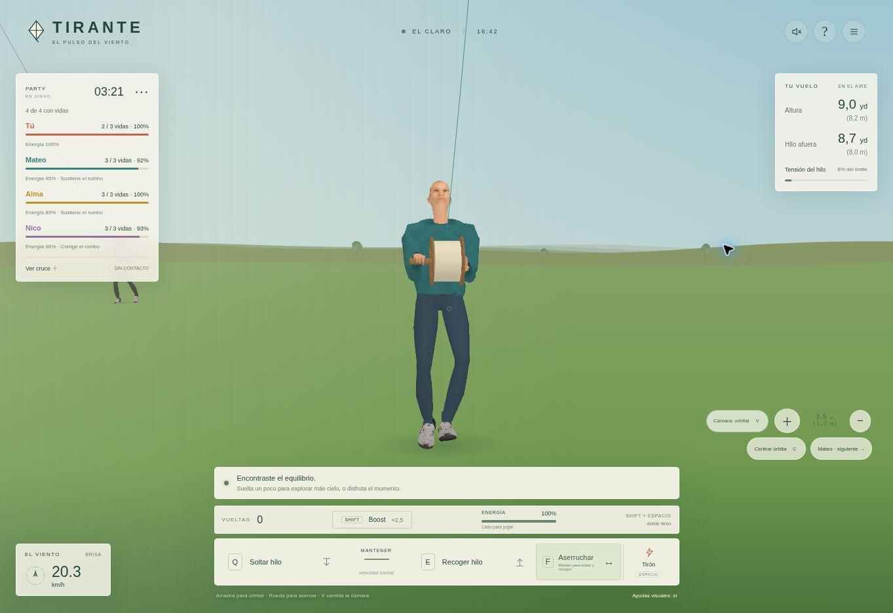
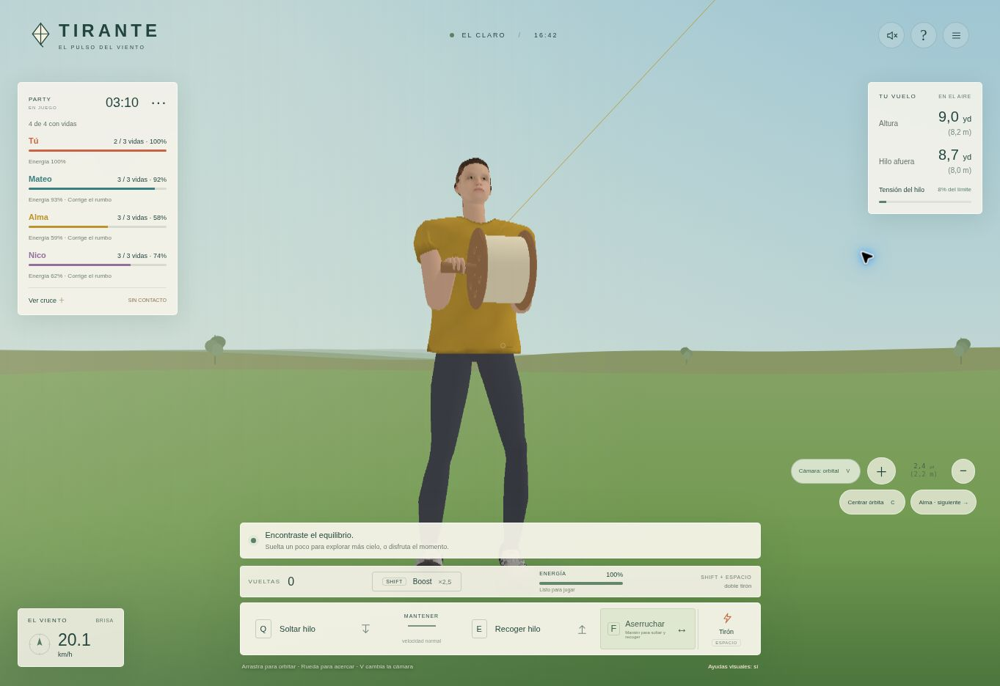
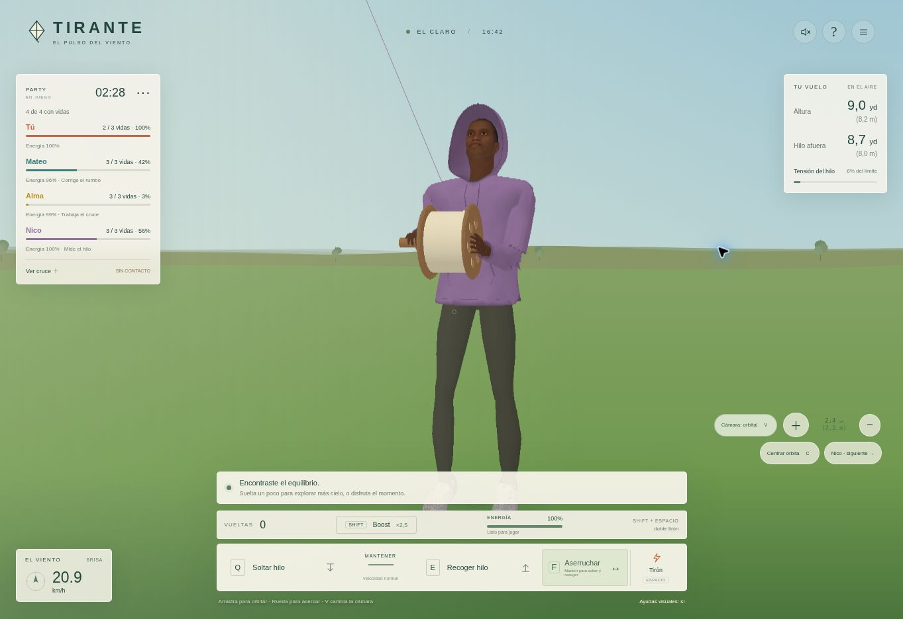

# Tirante 1.21 · Anatomía y deformación de ropa

## Problemas corregidos

La revisión se basa en las capturas del juego aportadas el 27 de octubre de 2026. La versión 1.20 invertía el lado anatómico al convertir la mano y asignaba la zapatilla izquierda al pie derecho. Además, la orientación de la mano guía doblaba la muñeca lateralmente, la reducción del busto alteraba la mandíbula y los tres rostros usaban una misma referencia de cuello pese a tener orígenes distintos.

- **Manos:** base de coordenadas corregida, pulgar en su lado anatómico, muñeca guía alineada con el antebrazo y codo por debajo del agarre. La mano de apoyo permanece en el mango fijo mientras gira el carrete. La mano libre baja siguiendo el antebrazo al quedar eliminado.
- **Cabeza y cuello:** registro individual usando el contorno inferior de cada cabeza; mentón original conservado. El cierre de la garganta se construye después de ajustar la base, incluyendo los bordes abiertos que ya contenía el archivo. La superficie continua del cuello se solapa dentro de la cabeza, sin atravesar la mandíbula. Su color se mezcla con el borde de la textura facial.
- **Calzado:** el recurso seleccionado corresponde a un pie izquierdo. Se refleja únicamente para el derecho y se conserva la apertura natural de las puntas y el apoyo calculado desde las suelas.
- **Ropa:** suavizado inicial de aristas irregulares, hombro con caída, secciones de manga ajustadas al brazo y puños contenidos. Los pesos de la axila dejan el torso unido al pecho. La interpolación por cuaterniones duales conserva el volumen durante la flexión; evita el aplanamiento y la torsión que producía la mezcla de matrices anterior. Los pliegues pequeños se concentran en la compresión interior del codo, con el exterior estirado y el forro acompañando la prenda.
- **Texturas:** se mantienen los UV por isla y material. El pelo de Alma incluye una base en el cuero cabelludo para que el recorte de las tarjetas no deje parches de piel desnuda.

La conservación de volumen sigue el principio documentado para [Preserve Volume del modificador Armature de Blender](https://docs.blender.org/manual/en/latest/modeling/modifiers/deform/armature.html). La implementación aquí es propia y funciona sobre las matrices rígidas del esqueleto de Tirante, en ambos renderers.

## Validación

- `npm run build`: aprobado; 92 módulos comprobados.
- `npm test`: aprobado; suite completa de vuelo, hilo, estabilidad, Party, vidas, online, cámaras, personalización y servidor, además de los casos de personajes.
- 216 poses de apariencia: muñecas a menos de 38° de la dirección del antebrazo, agarre fijo, dedos articulados, pausa, UV y buffers finitos.
- 54 poses de solidez: rayos alrededor de codos, muñecas y unión cabeza/cuello, cierre de garganta visto desde abajo, torso cubierto por la ropa y forro cerrado en ambos niveles de detalle.
- 72 combinaciones de ropa y detalle: ajuste de cintura/mangas, puntera interior en el lado correcto de cada pie y profundidad de Canvas.
- Deformación: transformación rígida exacta, conservación de radio y circunferencia en una sección de manga con giro de 180° y continuidad al cambiar el signo de los cuaterniones.
- Caminata: pies plantados, talón/punta, avance, retroceso, desplazamiento lateral, pausa y reaparición. El anclaje visible del carrete sigue coincidiendo con el físico.
- Revisión visual local de los tres personajes desde frente, perfil, espalda y abajo, tanto con mirada horizontal como elevada.

| NPC | Triángulos cerca | Triángulos lejos | Grupos de dibujo |
| --- | ---: | ---: | ---: |
| Mateo | 12.931 | 6.229 | 17 |
| Alma | 15.134 | 6.805 | 17 |
| Nico | 16.019 | 6.730 | 17 |

## Alcance

Los pliegues son deformaciones dirigidas por la postura, no una simulación física de tela. Los rostros conservan el detalle de los recursos recibidos, sin animación facial. No se alteran reglas de combate, controles ni físicas de vuelo. La inspección de navegador usa Canvas cuando WebGL no está disponible; no equivale a medir rendimiento o apariencia en una GPU real.

Solo se publican recursos adaptados al juego, código y verificaciones. Los archivos originales y las capturas privadas de referencia quedan fuera del repositorio. La procedencia y la información disponible sobre licencias permanecen en Créditos y `game/assets/licenses/`.

## Comprobación en producción · 27 de octubre de 2026

- Código publicado: `8f5a7d45709d259c087fc38156558a1b8d1a778f`.
- Render: `dep-dbgdgu6q1p3s739vivhg`, estado `live` a las 17:00:08 UTC.
- `/healthz`: HTTP 200, versión `1.21.0`. Los cinco módulos principales modificados y los dos atlas cambiados coinciden byte a byte con los archivos probados.
- Flujo título → nueva partida → Party → preparación → comienzo; alternancia entre Mateo, Alma y Nico, acercamiento y órbita. Probados soltar, recoger y tirón; tras tocar tierra apareció el espectador y se produjo el nuevo lanzamiento con una vida menos. El menú muestra `VERSIÓN 1.21.0`.
- Sin excepciones nuevas de lógica en el navegador. El entorno carece de contexto WebGL y activó la alternativa Canvas prevista. No se presenta como una comprobación de FPS o de GPU.

Capturas de la web con los recursos nuevos:

