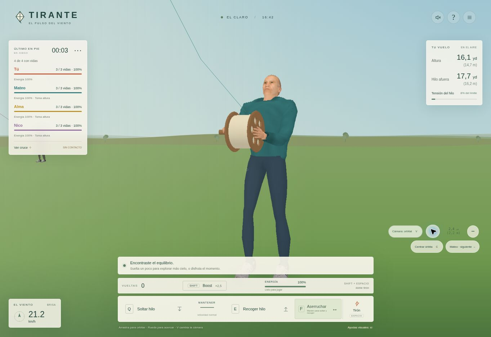
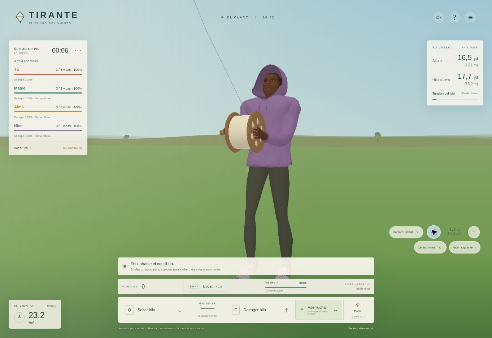

# Tirante 1.22 · Hilos, recogida y proporciones

## Cambios y causas

La vista de primera persona desplazaba toda la cuerda desde el anclaje físico hacia la salida del carrete. Las colisiones seguían en las coordenadas originales y el indicador podía quedar separado de los hilos. Ahora se conserva la polilínea física que asciende por el cielo; solo se representa una transición junto a la salida del carrete, sobre el tramo inferior oculto por la vista en primera persona. Si cualquier contacto ocupa ese tramo, se dibuja también su geometría física sin transición. Los puntos de contacto se vuelven a medir después de la resolución y, online, después de la interpolación. Un encuentro barrido ya separado no se muestra como contacto activo.

El bloqueo anterior reducía el movimiento de componentes enteros de cuerdas según el primer impacto. La nueva respuesta corrige localmente el movimiento que cierra un cruce; permite el deslizamiento tangencial y el avance de las partes libres. Se conserva la detección continua de segmentos, incluyendo encuentros rasantes y paralelos, pero una candidatura de la fase amplia no se acepta por sí sola como contacto. El radio de contacto es 0,35 mm por cuerda, frente a los 8 mm anteriores. Es una tolerancia común al mayor grosor seleccionable, no una separación visible de centímetros.

La cuerda resiste extensión, sin empujar sus partículas al comprimirse. Cuando hay varios cruces, la fuerza del volantín sigue el recorrido completo hasta el nudo real de los tirantes; no salta entre los puntos de contacto más fuertes. El giro libre queda limitado mientras el cruce está cargado. Los hilos cortados o de volantines en tierra dejan de bloquear las trayectorias.

Los tres tirantes tienen ocho segmentos cada uno, gravedad, amortiguación y respuesta al viento relativo. Sus extremos permanecen en los amarres del papel y en el mismo nudo usado por la cuerda principal. Las restricciones evitan que los nodos interiores atraviesen la cara del papel al girar. Los nudos pequeños siguen la curva. El contorno de madera exterior se sustituye por una línea de papel con 18% de opacidad; se mantienen los palillos central y transversal.

## Ajustes de juego

- Recogida base: **1,25 → 1,75 m/s**, antes de equipo, energía y boost. La suelta conserva su velocidad.
- Frenado por contacto: coeficiente **0,12 → 0,045**.
- Resistencia frente al viento: margen multiplicado por **1,25**. Se conserva la selección determinista del 10% de vuelos con ráfaga extrema; no significa que el 10% de todos los vuelos termine necesariamente en corte.
- La abrasión se aplica una vez por pareja de cuerdas y requiere contacto, presión y recorrido relativo. La recogida rápida continua cuenta como ataque; no depende de invertir Q/E. Aporta fibras nuevas al cruce y desgasta preferentemente el tramo opuesto. Un hilo propio ya sobrecargado puede romperse primero; no hay victoria automática por pulsar un botón.
- El carrete está centrado. Su fase de giro depende de la longitud recogida/soltada y del diámetro del equipo, con respuesta de 35/s y límite de 45 rad/s. Pausas y cambios de vida no generan saltos de giro.

## Personajes

Cabeza 6,5 cm más baja y cuello continuo reajustado, conservando mandíbula, textura, giro y unión con el torso. Las mangas usan una curva redondeada y orientada por la tangente alrededor del codo. El forro de la manga se reconstruye desde la superficie deformada: el desplazamiento del reposo dejaba salir caras interiores oscuras al doblarse. Los pequeños relieves, costuras y bolsillo del polerón tienen menos amplitud y contraste.

No se añaden triángulos ni grupos de dibujo a los NPC: Mateo 12.931/6.229, Alma 15.134/6.805 y Nico 16.019/6.730 triángulos en detalle cercano/lejano, 17 grupos cada uno. Se conservan caminata, agarre, calzado y niveles de detalle. Los menús quedan para una etapa posterior.

## Pruebas

- `npm run build`: aprobado, 94 módulos comprobados.
- `npm test`: aprobado de principio a fin; incluidos los 10 casos del servidor, online, física, personajes, cámaras y personalización.
- Contrarreloj completado en 29,10 s con controles reales y recogidas más cortas, sin alterar ruta, radio de recogida ni medallas.
- Regresiones de cruce continuo, encuentros paralelos/rasantes, autocontacto, suelo, anclajes, varios contactos, corte y serialización. Comprobación de 1.099.440 parejas de segmentos en vuelos naturales.
- Cuatro capacidades y tres ángulos de cámara: los segmentos aéreos dibujados conservan las coordenadas de colisión; el contacto en el tramo de salida desactiva la transición, aunque exista otro contacto más fuerte.
- Ataque continuo de 4 m/s y 3 N en un cruce controlado: corta el tramo contrario en menos de dos segundos, desde ambos lados. Contacto estático sin abrasión. Este tiempo corresponde a la prueba controlada, no a toda situación de partida.
- Tirantes durante giros, viento y pausa, extremos exactos y separación del papel; salida de hilo sin gancho en tres tamaños de pantalla.
- 72 casos de soltar/recoger: pico 15,24 m/s y estiramiento máximo 2,91 m. Capacidades de 300 y 1000 yd y recuperación de registros corruptos.
- Partidas naturales completas con 1, 2 y 3 NPC; escenarios de movimientos bruscos con cuatro participantes a 9 y 12 m/s.
- 54 poses de solidez, 72 combinaciones de ropa/detalle, 216 poses de apariencia y vistas laterales de las mangas para detectar exposición del forro.

## Límites

Es una simulación reducida para el juego, no una calibración experimental de hilo real. El solver tiene pasos e iteraciones acotados; las pruebas cubren los casos descritos, no una garantía matemática de todo enredo posible. Los tirantes son cadenas visuales restringidas, sin resolver contactos independientes con cada cuerda enemiga. La ropa se deforma según la postura y no usa simulación completa de tela. La revisión de navegador usa Canvas si no hay WebGL; eso no mide los FPS de una GPU real.

## Comprobación en producción · 28 de octubre de 2026

- Primera publicación: `35ae27799978e03348bf7cd6c09e81b6cfc9c47c`; Render `dep-dbh2ifi9lscs73800gfg`, estado `live` a las 16:57:17 UTC.
- `/healthz`: HTTP 200, versión `1.22.0`. Los módulos de colisiones, tirantes, carrete, mangas, física e interpolación online coinciden byte a byte con los probados.
- Navegador: título → menú → último en pie → preparación con 300 yd → partida con tres NPC. Revisados Mateo, Alma y Nico mediante cámara orbital; probados recoger con boost, soltar y doble tirón. La partida mantiene vidas y avance del reloj.
- La revisión visual detectó una transición demasiado brusca junto al carrete al encuadrar rivales a los lados. Se amplió su recorrido vertical según la distancia lateral y se volvió a validar salida, geometría de contacto y renderizado. Esta afinación no modifica las coordenadas físicas.
- Entorno de navegador con Canvas. Sin excepciones nuevas de la lógica del juego; los mensajes de la extensión del navegador son ajenos al juego. No se afirma una medición de FPS en GPU.

Capturas reales de la versión publicada:

